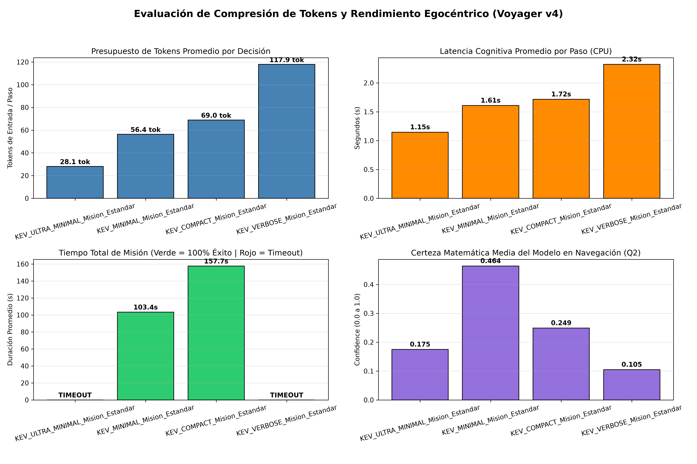
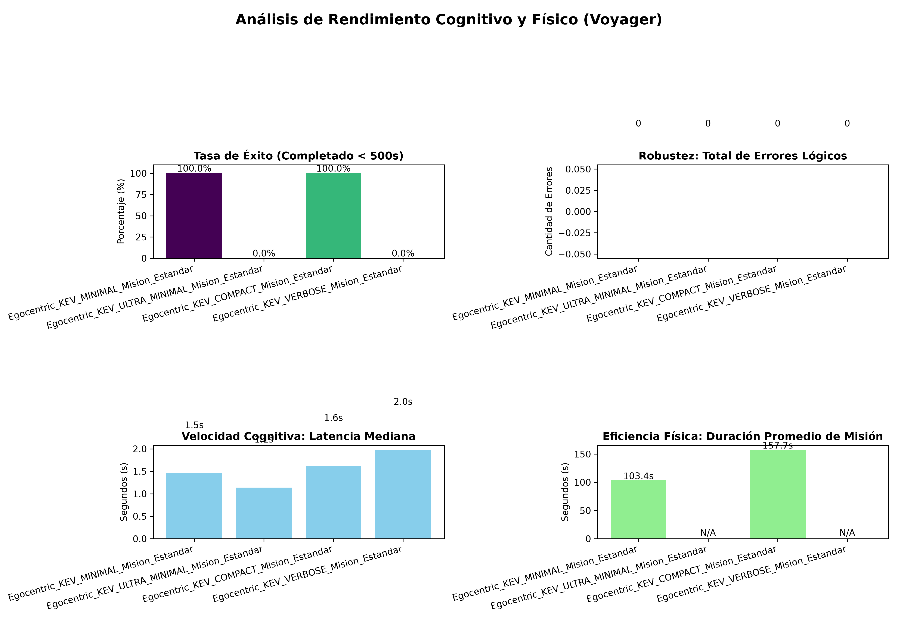

# Arquitectura Egocéntrica (Voyager 4)
**Estado**: Estable/Benchmark Validad | **Motor Óptimo**: `kev-0.8b` | **Configuración Ganadora**: `MINIMAL` (56.42 tokens/paso - 100% Éxito)

## 1. Descripcion General de la Arquitectura
A diferencia de las versiones anteriores (v1 a v3.5), donde el modelo de IA solo elegía un destino global y delegaba toda la locomoción al componente `NavMeshAgent` de Unity, Voyager v4 implementa un paradigma de Control Egocéntrico Discreto en Primera Persona.

En esta arquitectura, el agente carece de conocimiento omnisciente del mapa y controla directamente tanto el movimiento de su cuerpo como la dirección hacia donde mira su cámara paso a paso. El espacio continuo 3D se discretiza en una grilla lógica de celdas de 2x2 metros con rotaciones ortogonales de 90°.

## 2. Flujo Cognitivo-Motor: Cómo funciona el Agente
El ciclo de vida del agente (`AgentLoop` en `EgocentricVoyagerAgent.cs`) opera en un bucle continuo de tres etapas por cada turno físico:

### Etapa 1: Percepción Visual Activa y Clasificación a Distancia (`Q1 - /evaluate_entities`)
1. **Cono de Visión Frontal (Frustum Raycasting)**: En cada paso, el agente proyecta un cono de visión desde la posición de sus ojos (`viewDistance = 15.0m`, `fovAngle = 90°`).
2. **Validación de Línea de Visión (Line of Sight)**: Si un objeto entra dentro del ángulo del cono, Unity lanza rayos (`Physics.RaycastAll`) contra la capa `wallLayer` para verificar que no haya muros ni puertas cerradas obstruyendo la vista.
3. **Filtro Cognitivo Remoto (`Q1`)**: Si el objeto avistado a la distancia aún no está en la memoria del agente, se pausa el movimiento y se envía una consulta de clasificación a `/evaluate_entities`. El modelo evalúa la descripción del objeto frente a la misión actual y dictamina si es `USEFUL`o `USELESS`:
    * **`USEFUL` (Esfera Magenta en Gizmos)**: El objeto se registra en el diccionario `usefulEntities` con su ubicación exacta en la grilla, permitiendo que el agente lo recuerde aunque gire la cámara hacia otro lado.
    * **`USELESS` (Esfera Roja en Gizmos)**: El objeto se registra en `uselessEntities`, bloqueando cualquier intento futuro de interacción y tratándolo únicamente como un obstáculo físico a rodear.

### Etapa 2: Mapeo Espacial y Construcción de Estado Egocéntrico
Antes de pedirle al modelo que decida hacia dónde moverse o girar, el cliente C# actualiza sus tres memorias espaciales:
* **`inspectedCells`(Celdas Cian)**: Todas las baldosas del suelo que caen dentro del de visión actual (sin paredes de por medio) se marcan automáticamente como inspeccionadas a distancia. Esto evita que el agente tenga que caminar sobre baldosas vacías para saber que allí no hay nada.
* **`steppedCells`(Celdas Verdes)**: Registro de baldosas que el agente ya pisó físicamente.
* **`lookedAnglesAtCell`**: Registro de qué orientaciones cardinales ya observó el agente desde la baldosa actual, junto con un contador de `consecutiveTurns`(máximo 3 giros seguidos) para impedir bucles de rotación infinitos.

### Etapa 3: Toma de Decisión de Movimiento e Interacción (`Q2 - /plan_action`)
El agente envía las acciones físicas válidas en ese instante (`available_actions`) al endpoint `/plan_action`.
* `INTERACT: <entityId>`: Solo se habilita si un objeto clasificado como `USEFUL` está exactamente a 1 casilla frente al agente (`DIRECTLY_AHEAD`), no está bloqueado por fallos previos y el inventario del agente cumple con el requisito (`requireditem`) del objeto.
* **`MOVE_FORWARD`**: Solo se habilita si la casilla frontal no tiene pared (`IsDirectionBlocked`) ni está ocupada físicamente por el collider de una entidad (`IsCellOcuppiedByAnyEntity`).
* **`TURN_LEFT` (-90°), `TURN_RIGHT` (+90°), `TURN_AROUND` (180°)**: Opciones de rotación de camara/cuerpo para alinear la vista con objetivos o escanear la habitación.

## 3. Cómo se Integra el Movimiento Físico con el Modelo de IA
Los modelos de decisión pura pequeños (`kev-0.8b` y `laya`) no están diseñados para hacer cálculos trigonométricos crudos sobre coordenadas $(X, Z)$, pero son sumamente eficaces evaluando prioridades semánticas.

Para conectar el movimiento de grilla con el modelo sin usar `NavMesh`, el script `EgocentricVoyagerAgent.cs` traduce la geometría del entorno en **etiquetas semánticas direccionales** (`DescribeDirectionSector`) siguiendo una jerarquía de 4 niveles:
1. **Prioridad 1 $-$ Ruta hacia Objetivo Recordado (`ToTarget: <Subgoal>(N_steps_PRIORITY)`)**:
    * Si el agente ya vio con su cono de visión un objeto útil cuyos requisitos cumple (ej. vio una `Keycard` al inicio, o ya tiene la `Keycard` y recuerda dónde vio la `LockedDoor`, o ya tiene el `DataModule` y recuerda dónde está el `MainServer`), ejecuta un algoritmo **BFS (Breadth-Fist Search)** sobre la grilla (`FindFirstStepDirectionBFS`) esquivando paredes y chatarra.
    * La acción (`MOVE_FORWARD` o el giro correspondiente) que coincide con el primer paso de ese camino más corto recibe la etiqueta `Advance/Turn_ToTarget:<Objetivo>(N_steps_PRIORITY)`.
2. **Prioridad 2 $-$ Escaneo Visual Panorámico desde Lejos (`Turn_ScanRoomFromAfar(N_unseen_cells_PRIORITY)`)**:
    * Si el agente aún no ha visto el objeto que necesita (por ejemplo, al iniciar la partida o al entrar a una habitación nueva), antes de caminar a ciegas por los bordes evalúa con `FindBestVisualScanTurn` cuántas baldosas no inspeccionadas descubriría su cono de 24 metros si gira la cámara 90° o 180° en el mismo lugar.
    * Si un giro descubre $\ge 4$ celdas nuevas, lo rotula como prioridad de escaneo remoto.
3. **Prioridad 3 $-$ Avance hacia Frontera Desconocida (`ToUnexploredSector(N_steps_PRIORITY)`)**:
    * Cuando toda la habitación actual ya fue barrida con la mirada (o tras abrir una puerta que habilita un cuarto oculto), el BFS de frontera (`FindFirstStepToUnexploredBFS`) localiza la casilla no inspeccionada más cercana del mapa y marca la dirección hacia ella.
4. **Prioridad 4 $-$ Descarte de Sectores Revisados (`CheckedSector(Avoid)`)**:
    * Cualquier dirección que apunte hacia paredes o zonas ya barridas visualmente se etiqueta como `CheckedSector(Avoid)` (o se poda directamente si el ángulo ya fue mirado desde esa celda).

## 4. Estudio de Compresión de Tokens: Diferencias y Resultados
Para hallar la cantidad minima de tokens capaz de sostener la navegación egocéntrica y el razonamiento de misión, se evaluaron **4 perfiles de compresión** en `server_voyager_v4.py` sobre la misma misión de infiltración multi-etapa (`Keycard` $\rightarrow$ `LockedDoor` $\rightarrow$ `DataModule` $\rightarrow$ `MainServer`)

### Tabla de Resultados Experimentales (`kev-0.8b`)

Nivel de Compresión | Tokens / Paso | Tokens Totales / Misión |Latencia / Paso (s) | Duración Misión (s) | Pasos Promedio | Certeza Media Q2 | Tasa de Éxito (%)
------------- | ----- | ------------- | ------ | ------------- | --- | ----- | ----
`ULTRA_MINIMAL` | 28.13 | 0.0 *(Timeout)* | 1.1460 | 0.0 *(Timeout)* | 0.0 | 0.175 | 0.0%
`MINIMAL` **(Óptimo)** | 56.42 | 3043.0 | 1.6081 | 103.4493 | 53.9 | 0.464 | 100.0%
`COMPACT` | 68.95 | 5378.0 | 1.7160 | 157.6760 | 78.0 | 0.249 | 100.0%
`VERBOSE` | 117.89 | 0.0 *(Timeout)* | 2.3208 | 0.0 *(Timeout)* | 0.0 | 0.105 | 0.0%

### ¿Qué envía exactamente cada nivel y por qué ocurre este comportamiento?

1. **`ULTRA_MINIMAL` (28.13 token/paso) — Fallo por Sub-especificación Semántica**
    * **Estructura enviada**: En `Q2` elimina el objetivo del estado (state = "Act") y reemplaza todas las descripciones espaciales de las opciones por una palabra estática: `"Priority"` o `"Avoid"`.
    * **Causa del 0% de éxito**: Al borrar el nombre del objetivo (`Goal`) y la naturaleza de la acción (si es avanzar a un objeto, girar para escanear o explorar), cuando dos opciones comparten estado o cuando el modelo necesita contrastar el `state` contra los `<opt>`, la similitud semántica colapsa (certeza media de apenas 0.175). Demuestra que ~28 tokens está por debajo del límite de información mínima viable.
2. **`MINIMAL` (56.42 tokens/paso) — Punto Óptimo (Goldilocks Zone)** 
    * **Estructura enviada**:
        * **En `Q1`**: `Mission:<mission>|Obj:<type>:<description>` con pregunta `"Role in mission?"` y criterios directos.
        * **En `Q2`**: Estado ultra-limpio `Goal:<current_subgoal>`, instrucción `"Pick PRIORITY:"` y criterios que conservan el descriptor espacial exacto generado por Unity (`Advance_ToTarget:Keycard(2_steps_PRIORITY)` vs `CheckedSector(Avoid)`), mientras que las interacciones válidas se simplifican a `INTERACT_TARGET(PRIORITY)`.
    * **Por qué es el mejor**: Elimina el 100% del ruido conversacional pero conserva la alineación léxica exacta entre el `state` (`Goal:Keycard`) y la opción correcta (`...ToTarget:Keycard...PRIORITY`). Esto dispara la certeza matemática media a **0.464** (la más alta de todas las pruebas), logrando la ruta más corta (**53.9 pasos**) y reduciendo la latencia a **1.60s por paso** para completar el mapa en **103.4 segundos**.
3. **`COMPACT` (68.95 tokens/paso) — Degradación por Ruido de Estado**
    * **Estructura enviada**: Añade el inventario completo al estado de cada paso (`Inv:<inv_str> | Goal:<next_target>`) y una instrucción más larga (`"Pick INTERACT or the option marked PRIORITY. Avoid CheckedSector."`).
    * **Impacto**: Aunque mantiene el **100% de éxito**, esos **12.5 tokens extra** por paso introducen los nombres de los ítems ya recolectados en el `state` (ej. Inv:`Keycard`). El modelo clasificador sufre una leve distracción semántica con los ítems pasados, bajando su certeza a **0.249** y necesitando **78.0 pasos** (+24 pasos extra de indecisión) y **157.6 segundos** para terminar.
4. **`VERBOSE` (117.89 tokens/paso) — Colapso por Dilución de Atención y Latencia**
    * **Estructura enviada**: Envía un diccionario JSON completo con la misión entera, el inventario, la lista de todos los objetos actualmente en el cono de visión e instrucciones de varias oraciones en cada paso.
    * **Causa del 0% de éxito (en límite de tiempo estándar)**: Con ~118 tokens por paso, el exceso de palabras diluye los pesos de atención del modelo de 0.8B (bajando la certeza media en Q2 a 0.105) y eleva la latencia en CPU a 2.32s por paso (más de 185 segundos necesarios para completar la misión, superando el límite de timeout del benchmark).

# Resultados de las pruebas basicas
