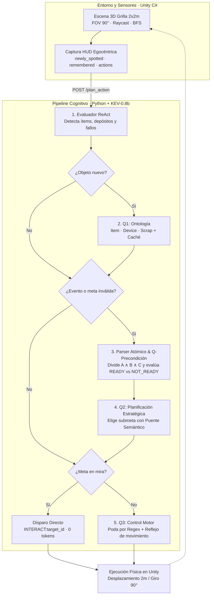

# Arquitectura Cognitiva Agnóstica Multi-Objetivo (Voyager v8)

**Estado:** Estable / Validado en Pruebas de Razonamiento Complejo  
**Motor de Decisión:** `kev-0.8b` (Sistema 1 — Ejecución 100% en CPU / 16 GB RAM)  
**Paradigma:** *Event-Driven ReAct* con Descomposición Atómica de Precondiciones Conjuntivas ($A \land B \land C$) y Puente Semántico.

---

## 1. Visión General y Evolución Arquitectónica

La versión **Voyager v8** evoluciona directamente desde la arquitectura egocéntrica orientada a eventos de la v6 para superar sus límites en escenarios de resolución de problemas no lineales. Mientras que las versiones anteriores resolvían dependencias simples de un solo objeto por paso, **v8** habilita al agente para operar en entornos con:

1. **Requisitos Múltiples Conjuntivos ($A \land B \land C$):** Entidades que exigen poseer o haber procesado varios elementos en simultáneo antes de activarse.
2. **Receptáculos y Consumo de Inventario (*Slots* / Estantes):** Estructuras fijas que retiran ítems del inventario del agente al interactuar y registran un estado de almacenamiento persistente en el entorno.
3. **Causalidad Ambiental sin Inventario:** Secuencias de interruptores, palancas y válvulas que desbloquean mecanismos posteriores mediante cambios de estado en la escena sin mediar objetos recolectables.
4. **Árboles de Dependencias Ramificados (DAG):** Misiones con múltiples ramas independientes que convergen en estaciones de ensamblaje antes de habilitar el objetivo final.

---

## 2. Flujo de Decisión del Agente

El sistema opera mediante un bucle cerrado entre el cuerpo físico en **Unity (C#)** y el planificador cognitivo en **Python (FastAPI + `kev-0.8b`)**:



---

## 3. Desglose de Consultas al Modelo (`kev-0.8b`)

Todas las consultas se realizan al endpoint `/v1/systemone` bajo el paradigma de clasificación estructurada (`type: "choice"`), evitando la generación autorregresiva de texto libre y garantizando latencias compatibles con tiempo real en CPU.

### 3.1. Q1: Percepción Semántica Universal (Ontología Funcional)

* **Propósito:** Determinar el rol físico de una entidad recién descubierta dentro del cono de visión ($110^\circ$).
* **Frecuencia:** **Una única vez por `type` de entidad**. El resultado se guarda en `entity_type_semantics_cache`, consumiendo **0 tokens** en avistamientos posteriores del mismo tipo.
* **Payload de contexto (`state`):**
  ```json
  {
    "entity": "Slot Energy",
    "description": "Energy receptacle. Requires: Battery. Effect: Stores Battery."
  }
  ```
* **Estructura de la pregunta (`questions`):**
  * **Clave:** `role`
  * **Instrucción:** `"Analyze '{spotted.type}' with description '{spotted.description}'. What functional role does this entity represent?"`
  * **Criterios (`criteria`):**
    * `PICKUP_ITEM`: *"A loose portable item lying on the ground (such as a keycard, key, cartridge, data drive, battery, fuse, circuit, or tool) that can be picked up into inventory."*
    * `ENVIRONMENT_DEVICE`: *"A fixed stationary structure, door, barrier, slot, chest, vault, switch, valve, machine, terminal, or console in the room that can be operated or unlocked."*
    * `USELESS_SCRAP`: *"Inert scrap metal, rubble, junk, or debris that has no practical function."*

---

### 3.2. Q-Precondición: Verificación Atómica de Cláusulas en Batch

* **Propósito:** Evitar el secuestro léxico por coincidencia parcial cuando un dispositivo exige múltiples requisitos ($A \land B \land C$).
* **Mecanismo de Descomposición (`extract_atomic_requirements`):** Antes de consultar al modelo, Python limpia la cláusula `Effect:` y fragmenta los requisitos separados por comas (`,`), `and`, `y` o `&` en condiciones individuales.
  * *Ejemplo:* `"Requires: Battery, circuit and fuse must be stored."` $\rightarrow$ `["Battery", "circuit", "fuse must be stored"]`.
* **Selección de Pool de Estado:** Si la descripción contiene palabras clave de estado ambiental (`stored`, `activated`, `almacenado`, `activado`, `turned on`), la verificación se contrasta exclusivamente contra `stored_and_activated_states` (`completed_states_memory`), obligando al agente a depositar los ítems en los receptáculos antes de activar el terminal final. En caso contrario, se evalúa contra la unión de `held_inventory` y `completed_states_memory`.
* **Payload de contexto (`state`):**
  ```json
  {
    "held_inventory": "Battery",
    "stored_and_activated_states": "Circuit stored in Slot_Logic, Fuse stored in Slot_Protection",
    "all_current_progress": "Battery, Circuit stored in Slot_Logic, Fuse stored in Slot_Protection"
  }
  ```
* **Estructura de la pregunta (una entrada por cada cláusula `idx` de cada dispositivo `d` en una sola petición HTTP):**
  * **Clave:** `can_use_{d.id}_{idx}`
  * **Instrucción:** `"Compare current state [{target_pool_str}] with the single requirement '{clause}' for '{d.type}'. Is '{clause}' present or satisfied in [{target_pool_str}]?"`
  * **Criterios (`criteria`):**
    * `READY`: *"YES. The required condition '{clause}' is present in [{target_pool_str}]."*
    * `NOT_READY`: *"NO. The required condition '{clause}' is missing from [{target_pool_str}]."*
* **Regla de Viabilidad Conjuntiva:** Un dispositivo ingresa a `actionable_entities` únicamente si el **100% de sus cláusulas atómicas** obtienen `READY`. De lo contrario, se deriva a `locked_devices`.

---

### 3.3. Q2: Selección de Meta Estratégica con Puente Semántico

* **Propósito:** Elegir qué entidad operable ejecutar a continuación para desbloquear los objetivos pendientes de la misión.
* **Frecuencia:** Exclusiva ante eventos (`trigger_replan`, descubrimiento de entidad útil o invalidación de meta). Si `len(actionable_entities) == 1`, se ancla automáticamente con **Confianza 1.00 y 0 tokens**.
* **Puente Semántico (`locked_goals_to_unlock`):** En misiones breves (ej. *"Turn on the PC"*), los requisitos reales residen en la descripción del dispositivo bloqueado. V8 inyecta las descripciones de `locked_devices` en el contexto de Q2 (sin incluirlos como opciones elegibles) para que el modelo relacione las precondiciones con las submetas disponibles. Además, se omite `EXPLORE` de los criterios cuando existen entidades accionables, erradicando la evasión hacia la exploración.
* **Payload de contexto (`state`):**
  ```json
  {
    "mission": "Turn on the PC.",
    "locked_goals_to_unlock": "- PC (PC): PC. Requires: Battery, circuit and fuse must be stored. Effect: Turn on the PC.",
    "current_inventory": "Battery",
    "ready_targets": "- Slot_Energy (Slot Energy): Energy slot. Requires: Battery. Effect: Stores Battery."
  }
  ```
* **Estructura de la pregunta (`questions`):**
  * **Clave:** `decision`
  * **Instrucción:** `"Mission: '{state.mission}'. Locked goals requirements: [{locked_str}]. All listed ready_targets are accessible right now with current_inventory [{inv_str}]. Which entity do you target to progress in the mission?"`
  * **Criterios (`criteria`):**
    * `{e.id}`: `"Interact with {e.type} ({e.id}): {e.description}"` (para cada entidad en `actionable_entities`).

---

### 3.4. Q3: Navegación Motora Egocéntrica Podada

* **Propósito:** Seleccionar la acción física inmediata (`MOVE_FORWARD`, `TURN_LEFT`, `TURN_RIGHT`, `TURN_AROUND`) que aproxima al agente hacia `active_target_id` o hacia áreas sin explorar.
* **Frecuencia:** En cada celda donde existan 2 o más movimientos válidos y la meta no se encuentre aún en el punto de mira (`CROSSHAIR`).
* **Payload de contexto (`state`):**
  ```json
  {
    "current_target": "Slot_Energy"
  }
  ```
* **Estructura de la pregunta (`questions`):**
  * **Clave:** `step`
  * **Instrucción:** `"Select the action that leads directly to target {active_target_id}."` (o `"Select the action that leads to an Unexplored area or Scan."` si la meta es `EXPLORE`).
  * **Criterios (`criteria` tras poda sintáctica por Regex):**
    ```json
    {
      "MOVE_FORWARD": "Leads directly to target Slot_Energy (3 steps)",
      "TURN_LEFT": "Does not lead to current target",
      "TURN_RIGHT": "Does not lead to current target"
    }
    ```

---

## 4. Scaffolding Algorítmico y Ayudas del Código

La arquitectura distribuye la carga determinista entre C# y Python para compensar las limitaciones de atención espacial y memoria de un modelo de 0.8B parámetros:

### 4.1. Lóbulo Sensoriomotor en Unity (`EgocentricVoyagerAgent_v8.cs` & `GridEntity_v8.cs`)
* **Modelo de Entidad Polimórfica (`GridEntity_v8`):** Soporta listas de ítems requeridos (`requiredItems`), consumo automático del inventario al depositar en receptáculos (`consumesRequiredItems`), dependencias de activación entre objetos de la escena (`requiredActiveEntities`), entrega múltiple de recompensas (`grantsItems`) y estado booleano persistente (`isActivated`).
* **Discretización Espacial Rígida ($2 \times 2\text{ m}$):** `SnapToGrid()` alinea posición y rotación en múltiplos exactos de `cellSize` ($2.0\text{ m}$) y $90^\circ$, eliminando deriva física.
* **Detección Volumétrica Anti-Colisión:**
  * `IsDirectionBlockedByWall`: Combina `Physics.CheckBox` sobre la celda destino con un `Physics.Raycast` de $1.15 \times \text{cellSize}$ a $0.5\text{ m}$ del suelo, impidiendo pisar bordes de muros.
  * `IsCellOccupiedBySolidEntity`: Ejecuta `Physics.OverlapBox` con semialto de $1.2\text{ m}$ desde el nivel del piso, detectando tanto cubos bajos de $1 \times 1 \times 1\text{ m}$ como consolas altas para que el BFS rodee todos los obstáculos.
* **Cálculo de Adyacencia Cardinal (`CanInteractFromCell`):** Evalúa distancia Manhattan igual a $1$ o proximidad de colisionador dentro de un cono estricto de $25^\circ$, evitando falsos bloqueos en pasillos adyacentes y reportando la entidad en `CROSSHAIR` (`0 steps`) únicamente cuando está alineada frente al agente.
* **Pathfinding Topológico Egocéntrico (BFS):** Calcula en tiempo real los pasos exactos y la primera dirección cardinal hacia cada entidad recordada y hacia celdas no inspeccionadas (`inspectedCells`).
* **Seguro Anti-Parálisis:** Si las restricciones de giro agotan las opciones motoras en una celda (`moveOptionsCount == 0`), reinicia `consecutiveTurns` y limpia `lookedAnglesAtCell` antes de emitir `TURN_AROUND`.

### 4.2. Lóbulo Cognitivo en Python (`server_voyager_v8.py`)
* **Memoria de Estados Ambientales (`completed_states_memory`):** Registra de forma persistente ítems depositados (`"{item} stored in {slot_id}"`) y mecanismos activados (`"{device_id} activated and stored"`), permitiendo verificar precondiciones sin inventario físico.
* **Memoria de Frustración Episódica (`entity_feedback_memory`):** Si una interacción física devuelve `FAILED`, la entidad se bloquea temporalmente hasta que ocurra un cambio real en el inventario o en los estados completados de la sala.
* **Bypass Determinista de Interacción:** Si `INTERACT:{active_target_id}` está disponible en `available_actions` (meta a `0 steps`), ejecuta la interacción de inmediato sin invocar Q3 (`0 tokens`, `0.00s` de latencia).
* **Priorización de Ruta Directa:** Cuando Q3 evalúa movimientos hacia una meta específica y el mapa BFS identifica una única dirección directa, corrige cualquier desviación estocástica del modelo.

---

## 5. Resultados Experimentales y Límites Observados

Las pruebas ejecutadas sobre `Agnostic_ReAct_V8_KEV` (registradas en `Voyager_Architecture_v8_Agnostica.json`) demuestran el alcance y las fronteras cognitivas de la arquitectura:

| Prueba / Escenario | Estado | Pasos | Duración | Tokens/Paso | Hallazgo Cognitivo |
| :--- | :---: | :---: | :---: | :---: | :--- |
| **Secuencia de Interruptores** | Éxito | 21 | 57.85 s | 122.38 | Resolución exacta ($1 \rightarrow 2 \rightarrow 3$) sin errores gracias a `completed_states_memory`. |
| **Distractores Semánticos (*Lexical Hijacking*)** | Éxito | 4 | 24.15 s | 277.00 | Discrimina funcionalidad real (*Wrench*) frente a distractores léxicos (*Gold key*, *Master card*). |
| **Reactor Multiobjeto ($A \land B$)** | Éxito | 32 | 77.14 s | 102.47 | La descomposición atómica impide acudir al reactor hasta recolectar ambos componentes. |
| **Reto de Receptáculos (*Slots*)** | Éxito | 78 | 234.99 s | 143.71 | Gestiona recolección, depósito con consumo de inventario y activación final de la PC. |
| **Cadena Secuencial Profunda (4 niveles)** | Éxito | 46 | 108.93 s | 101.74 | Mantiene coherencia en cadenas lineales de 4 etapas (*Key $\rightarrow$ Chest $\rightarrow$ Terminal $\rightarrow$ Vault*). |
| **Restricción Negativa Excluyente** | Éxito | 23 | 71.16 s | 142.35 | Evidencia *negation blindness* en Q1/Q2 (recoge la batería dañina), pero ReAct corrige y completa la misión. |
| **Árbol Causal Ramificado (DAG)** | Éxito | 109 | 285.19 s | 124.93 | Resuelve dos ramas independientes y ensamblaje convergente; muestra sesgo ávido (*greedy check*) hacia la meta final. |
| **Secuencia Ambiental Irreversible** | Éxito | 23 | 54.71 s | 110.09 | Ejecución impecable de precondiciones encadenadas sin ítems en inventario. |
| **Propiedades Químicas Implícitas** | Timeout | 59 | 30.00 s | 97.81 | Límite de Q1: términos sin palabras clave de dispositivo (*Thermal core*, *Corrosive container*) se clasifican como chatarra. |